# Entity Relationship Diagram (ERD)
# PeopleCore HRIS

| Information | Detail |
|---|---|
| Project | PeopleCore HRIS |
| Document | Entity Relationship Diagram |
| Version | 1.0 |
| Status | Draft |
| Database | PostgreSQL |
| Primary Key | UUID |
| Architecture | Modular Monolith |
| Reference | PeopleCore HRIS PRD v1.0 |

---

# 1. Database Overview

## 1.1 Introduction

Dokumen ini menjelaskan rancangan database untuk PeopleCore HRIS (Human Resource Information System).

Database dirancang untuk mendukung seluruh kebutuhan pengelolaan sumber daya manusia perusahaan, termasuk:

- Authentication & Authorization
- Employee Management
- Organization Management
- Attendance Management
- Leave Management
- Payroll Management
- Contract Management
- Performance Management
- Recruitment Management
- Training & Development
- Document Management
- Notifications
- Audit Trail

Database menggunakan PostgreSQL dengan pendekatan relational database untuk menjaga konsistensi, integritas, dan keterhubungan data antar modul.

## 1.2 Database Design Principles

Prinsip perancangan database:

1. Menggunakan UUID sebagai primary key.
2. Menggunakan foreign key untuk menjaga referential integrity.
3. Menggunakan unique constraints untuk data yang membutuhkan identitas unik.
4. Menggunakan indexes pada kolom yang sering digunakan dalam pencarian dan filtering.
5. Menggunakan database transactions untuk operasi bisnis kritis.
6. Menggunakan `created_at` dan `updated_at` untuk mencatat waktu perubahan data.
7. Menggunakan soft delete untuk data yang memiliki riwayat bisnis.
8. Menggunakan exact numeric types untuk penyimpanan nilai uang.
9. Memisahkan data master dan transactional data.
10. Menyimpan historical records untuk perubahan informasi pekerjaan, gaji, dan kontrak.

## 1.3 Naming Convention

| Element | Convention | Example |
|---|---|---|
| Table | snake_case, plural | employees |
| Column | snake_case | employee_id |
| Primary Key | id | id |
| Foreign Key | referenced_table_id | department_id |
| Boolean | is_ prefix | is_active |
| Timestamp | _at suffix | created_at |
| Date | _date suffix | hire_date |

## 1.4 Standard Column Convention

Sebagian besar tabel menggunakan kolom berikut:

| Column | Type | Description |
|---|---|---|
| id | UUID | Primary key |
| created_at | TIMESTAMPTZ | Record creation timestamp |
| updated_at | TIMESTAMPTZ | Last update timestamp |

Kolom tambahan sesuai kebutuhan:

| Column | Type | Description |
|---|---|---|
| deleted_at | TIMESTAMPTZ | Soft deletion timestamp |
| created_by | UUID | User who created the record |
| updated_by | UUID | User who last updated the record |

Tidak semua tabel wajib memiliki seluruh kolom tersebut. Tabel transaksi dan historical records dapat menggunakan struktur timestamp khusus sesuai kebutuhan.

---

# 2. Database Domains

Database PeopleCore HRIS dibagi menjadi 12 domain.

| No. | Domain | Main Tables |
|---|---|---|
| 1 | Authentication | users, roles, permissions, user_roles, role_permissions, refresh_tokens |
| 2 | Employee | employees, employee_contacts, employee_addresses, employee_emergency_contacts, employee_bank_accounts, employee_employment_histories |
| 3 | Organization | companies, branches, departments, divisions, positions, job_grades |
| 4 | Attendance | attendance_records, work_shifts, work_schedules, attendance_corrections, holidays |
| 5 | Leave | leave_types, leave_policies, leave_balances, leave_requests, leave_approvals |
| 6 | Payroll | salary_structures, salary_components, payroll_periods, payroll_records, payroll_items, payroll_adjustments, payslips |
| 7 | Contract | employee_contracts, contract_documents |
| 8 | Performance | kpis, evaluation_periods, performance_reviews, performance_scores, performance_feedback |
| 9 | Recruitment | job_vacancies, applicants, interviews, job_offers |
| 10 | Training | training_programs, training_participants, training_attendances, training_certificates |
| 11 | Documents | documents, employee_documents |
| 12 | System | notifications, audit_logs |

---

# 3. Entity Relationship Diagram

ERD dibagi menjadi beberapa bagian berdasarkan domain agar diagram mudah dibaca dan dikelola.

## 3.1 Authentication & Authorization ERD

Mengelola akun pengguna, role, permission, dan refresh token.

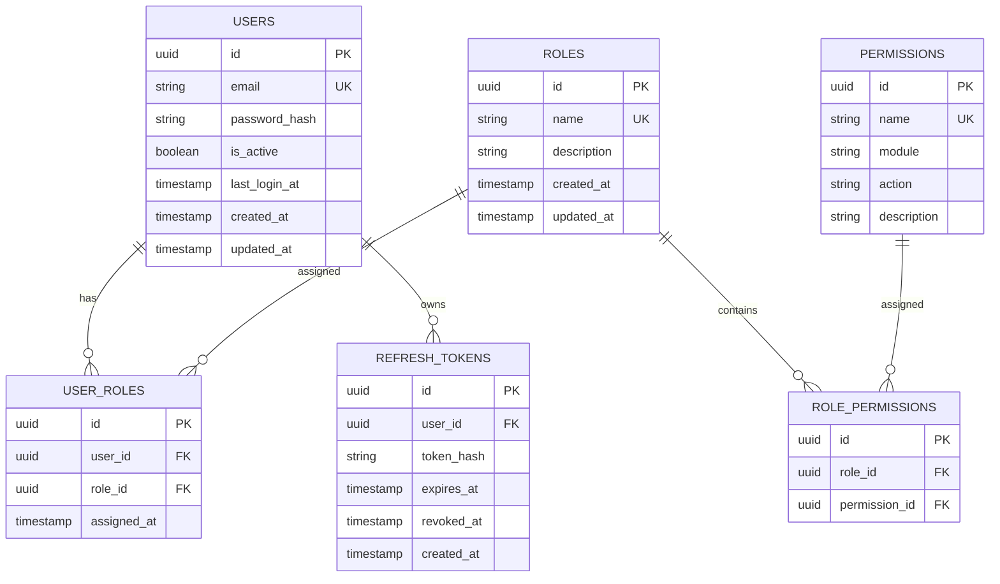

### Entity Description

**users**

Menyimpan informasi akun pengguna aplikasi.

**roles**

Menyimpan daftar role pengguna.

Contoh:
- Super Admin
- HR Admin
- HR Manager
- Department Manager
- Employee

**permissions**

Menyimpan daftar permission berdasarkan modul dan tindakan.

Contoh:
- employees.create
- employees.read
- employees.update
- employees.delete
- payroll.process
- payroll.approve
- leaves.approve

**user_roles**

Tabel penghubung many-to-many antara users dan roles.

**role_permissions**

Tabel penghubung many-to-many antara roles dan permissions.

**refresh_tokens**

Menyimpan hash refresh token untuk pengelolaan sesi autentikasi.

### Relationships

- One User can have multiple Roles.
- One Role can belong to multiple Users.
- One Role can have multiple Permissions.
- One Permission can belong to multiple Roles.
- One User can have multiple Refresh Tokens.

---

## 3.2 Employee Management ERD

Mengelola informasi pribadi, kontak, rekening bank, alamat, dan riwayat pekerjaan karyawan.

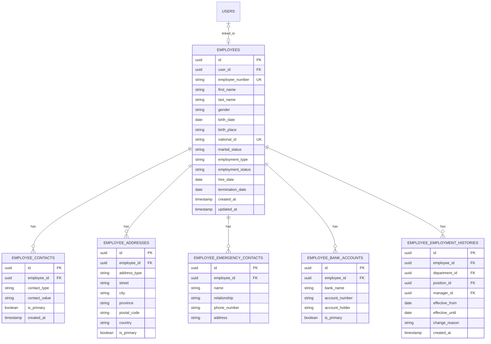

### Entity Description

**employees**

Tabel utama yang menyimpan identitas dan informasi pekerjaan karyawan.

**employee_contacts**

Menyimpan informasi kontak seperti email pribadi dan nomor telepon.

**employee_addresses**

Menyimpan alamat tempat tinggal dan alamat lainnya.

**employee_emergency_contacts**

Menyimpan kontak darurat karyawan.

**employee_bank_accounts**

Menyimpan informasi rekening bank untuk kebutuhan penggajian.

**employee_employment_histories**

Menyimpan riwayat perubahan departemen, posisi, dan atasan.

### Relationships

- One User can be linked to one Employee.
- One Employee can have multiple Contacts.
- One Employee can have multiple Addresses.
- One Employee can have multiple Emergency Contacts.
- One Employee can have multiple Bank Accounts.
- One Employee can have multiple Employment Histories.

---

## 3.3 Organization Management ERD

Mengelola perusahaan, cabang, departemen, divisi, posisi, dan job grade.

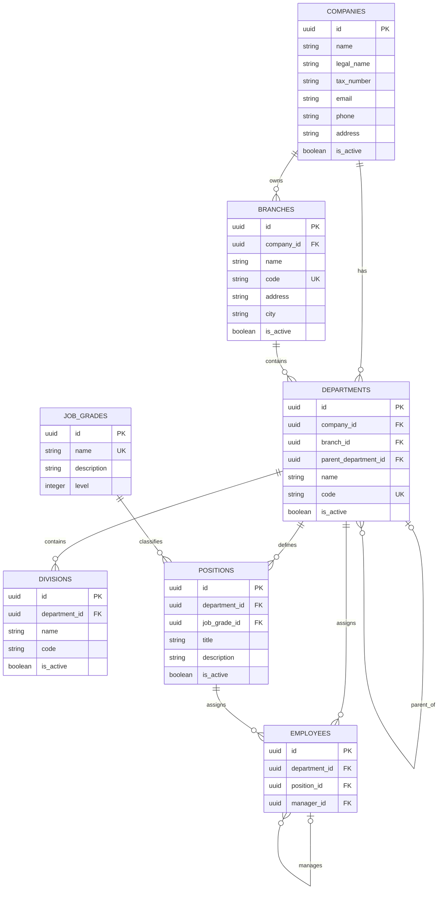

### Entity Description

**companies**

Menyimpan identitas perusahaan.

**branches**

Menyimpan daftar cabang perusahaan.

**departments**

Menyimpan departemen dan mendukung struktur parent-child.

**divisions**

Menyimpan divisi dalam suatu departemen.

**positions**

Menyimpan jabatan yang tersedia dalam organisasi.

**job_grades**

Menyimpan tingkat atau grade jabatan.

### Relationships

- One Company has multiple Branches.
- One Company has multiple Departments.
- One Branch can have multiple Departments.
- One Department can have multiple Sub-departments.
- One Department can have multiple Divisions.
- One Department can have multiple Positions.
- One Job Grade can be assigned to multiple Positions.
- One Department can have multiple Employees.
- One Position can be assigned to multiple Employees.
- One Employee can manage multiple Employees.

Catatan: relasi organisasi aktif disimpan pada tabel employees sebagai referensi penempatan saat ini. Riwayat perubahan penempatan disimpan pada employee_employment_histories.

---

## 3.4 Attendance Management ERD

Mengelola kehadiran, jadwal kerja, shift, koreksi kehadiran, dan hari libur.

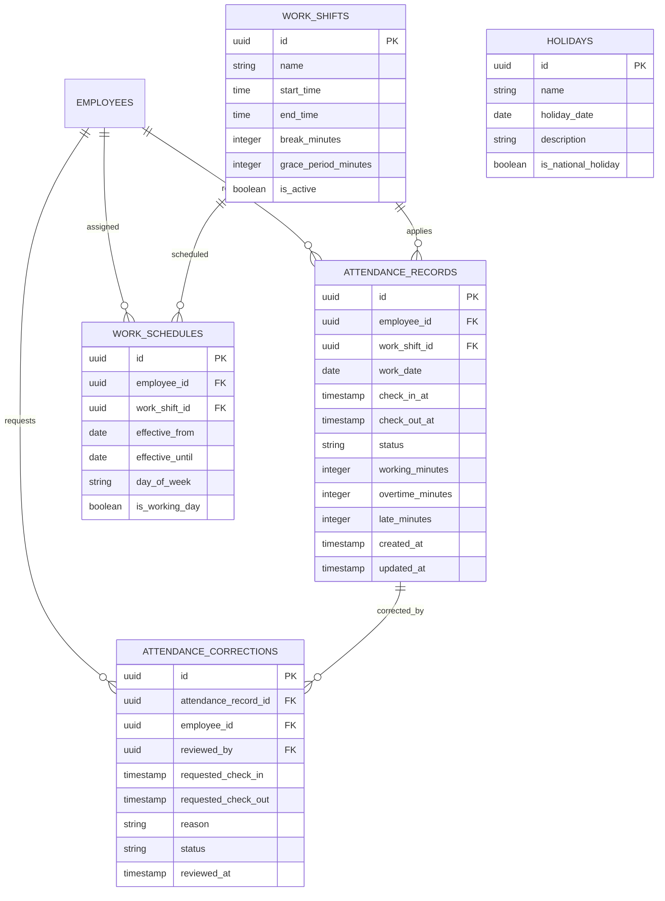

### Entity Description

**attendance_records**

Menyimpan catatan check-in dan check-out karyawan.

**work_shifts**

Menyimpan konfigurasi shift kerja.

**work_schedules**

Menyimpan jadwal kerja karyawan berdasarkan periode dan hari.

**attendance_corrections**

Menyimpan permintaan koreksi data kehadiran.

**holidays**

Menyimpan kalender hari libur perusahaan.

### Relationships

- One Employee can have multiple Attendance Records.
- One Work Shift can be used by multiple Attendance Records.
- One Employee can have multiple Work Schedules.
- One Work Shift can be assigned to multiple Work Schedules.
- One Attendance Record can have multiple Correction Requests.
- One Employee can submit multiple Correction Requests.

---

## 3.5 Leave Management ERD

Mengelola jenis cuti, kebijakan, saldo, pengajuan, dan approval.

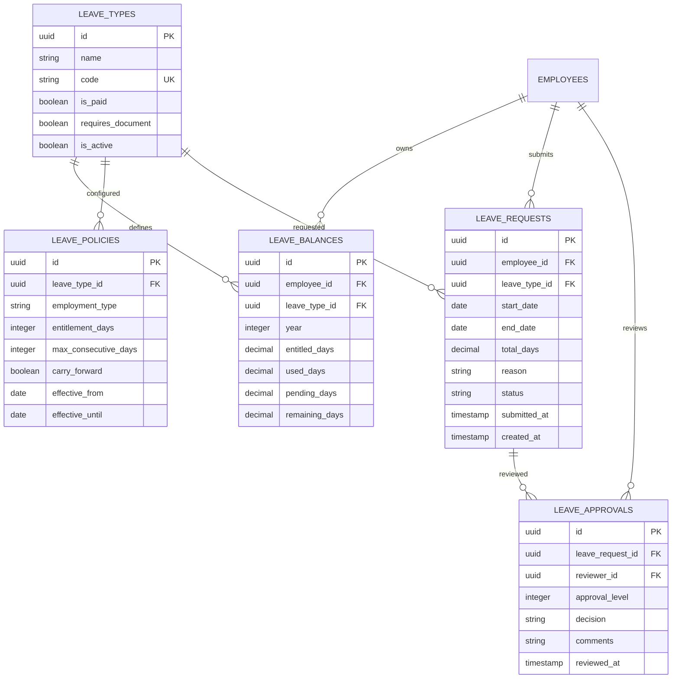

### Entity Description

**leave_types**

Menyimpan jenis cuti yang tersedia.

**leave_policies**

Menyimpan kebijakan dan aturan saldo cuti.

**leave_balances**

Menyimpan saldo cuti per karyawan, jenis cuti, dan tahun.

**leave_requests**

Menyimpan pengajuan cuti.

**leave_approvals**

Menyimpan riwayat proses persetujuan.

### Relationships

- One Employee can have multiple Leave Balances.
- One Leave Type can have multiple Leave Balances.
- One Leave Type can have multiple Leave Policies.
- One Employee can submit multiple Leave Requests.
- One Leave Type can be requested by multiple Employees.
- One Leave Request can have multiple Approval Records.
- One Employee can review multiple Leave Requests.

---

## 3.6 Payroll Management ERD

Mengelola struktur gaji, komponen penghasilan, periode payroll, hasil perhitungan, dan payslip.

```mermaid
erDiagram
    EMPLOYEES ||--o{ SALARY_STRUCTURES : assigned
    SALARY_STRUCTURES ||--o{ SALARY_COMPONENTS : contains
    PAYROLL_PERIODS ||--o{ PAYROLL_RECORDS : contains
    EMPLOYEES ||--o{ PAYROLL_RECORDS : receives
    PAYROLL_RECORDS ||--o{ PAYROLL_ITEMS : consists
    PAYROLL_RECORDS ||--o| PAYSLIPS : generates
    EMPLOYEES ||--o{ PAYROLL_ADJUSTMENTS : receives

    SALARY_STRUCTURES {
        uuid id PK
        uuid employee_id FK
        decimal base_salary
        date effective_from
        date effective_until
        string status
        timestamp created_at
    }

    SALARY_COMPONENTS {
        uuid id PK
        uuid salary_structure_id FK
        string component_name
        string component_type
        decimal amount
        boolean is_taxable
        boolean is_recurring
    }

    PAYROLL_PERIODS {
        uuid id PK
        string period_name
        date start_date
        date end_date
        date payment_date
        string status
        uuid processed_by FK
        uuid approved_by FK
        timestamp created_at
    }

    PAYROLL_RECORDS {
        uuid id PK
        uuid payroll_period_id FK
        uuid employee_id FK
        decimal gross_salary
        decimal total_deductions
        decimal net_salary
        string status
        timestamp finalized_at
        timestamp created_at
    }

    PAYROLL_ITEMS {
        uuid id PK
        uuid payroll_record_id FK
        string component_name
        string component_type
        decimal amount
        string description
    }

    PAYROLL_ADJUSTMENTS {
        uuid id PK
        uuid employee_id FK
        uuid payroll_period_id FK
        string adjustment_type
        decimal amount
        string reason
        uuid created_by FK
        timestamp created_at
    }

    PAYSLIPS {
        uuid id PK
        uuid payroll_record_id FK
        string document_path
        timestamp generated_at
        timestamp published_at
    }
```

### Entity Description

**salary_structures**

Menyimpan struktur gaji karyawan berdasarkan periode berlaku.

**salary_components**

Menyimpan komponen penghasilan tetap dan berulang.

Contoh:
- Basic salary.
- Transport allowance.
- Meal allowance.
- Position allowance.

**payroll_periods**

Menyimpan periode penggajian.

**payroll_records**

Menyimpan hasil perhitungan gaji setiap karyawan dalam satu periode.

**payroll_items**

Menyimpan rincian penghasilan dan potongan payroll.

**payroll_adjustments**

Menyimpan penyesuaian penggajian.

**payslips**

Menyimpan referensi dokumen slip gaji.

### Relationships

- One Employee can have multiple Salary Structures over time.
- One Salary Structure can have multiple Salary Components.
- One Payroll Period can have multiple Payroll Records.
- One Employee can have multiple Payroll Records.
- One Payroll Record can have multiple Payroll Items.
- One Payroll Record can generate one Payslip.
- One Employee can have multiple Payroll Adjustments.

### Payroll Data Integrity

1. Satu karyawan hanya boleh memiliki satu payroll record per payroll period.
2. Salary structure harus mengikuti effective date.
3. Payroll items menyimpan snapshot komponen gaji pada saat perhitungan.
4. Payroll yang telah difinalisasi tidak boleh diubah langsung.
5. Perubahan payroll harus dilakukan melalui adjustment.
6. Payroll processing harus menggunakan database transaction.
7. Payroll harus memiliki approval sebelum finalisasi.

---

## 3.7 Contract Management ERD

Mengelola kontrak kerja dan riwayat dokumen kontrak.

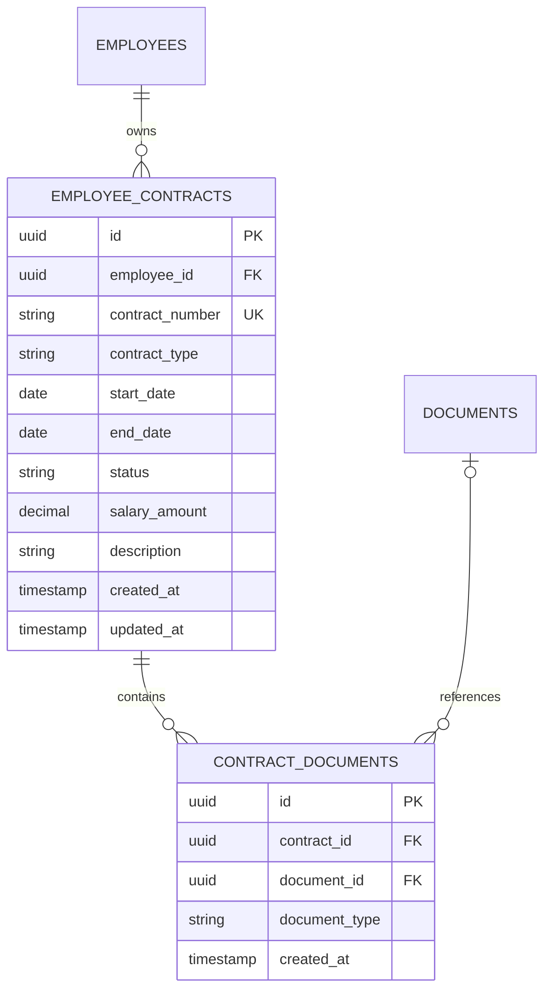

### Entity Description

**employee_contracts**

Menyimpan informasi kontrak kerja.

Jenis kontrak:
- PKWT.
- PKWTT.

**contract_documents**

Menghubungkan kontrak kerja dengan dokumen terkait.

### Relationships

- One Employee can have multiple Contracts.
- One Contract can have multiple Contract Documents.
- One Document can be referenced by multiple Contract Document records jika kebijakan penyimpanan mengizinkan.

---

## 3.8 Performance Management ERD

Mengelola KPI, periode evaluasi, hasil penilaian, dan feedback.

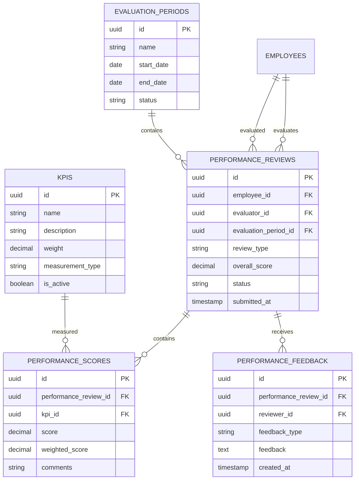

### Entity Description

**kpis**

Menyimpan indikator penilaian kinerja.

**evaluation_periods**

Menyimpan periode evaluasi.

**performance_reviews**

Menyimpan hasil evaluasi seorang karyawan.

**performance_scores**

Menyimpan nilai setiap KPI.

**performance_feedback**

Menyimpan feedback dari evaluator.

### Relationships

- One KPI can be used in multiple Performance Scores.
- One Evaluation Period can contain multiple Performance Reviews.
- One Employee can have multiple Performance Reviews.
- One Employee can act as Evaluator for multiple Performance Reviews.
- One Performance Review can have multiple Performance Scores.
- One Performance Review can have multiple Feedback Records.

---

## 3.9 Recruitment Management ERD

Mengelola lowongan pekerjaan, pelamar, interview, dan penawaran kerja.

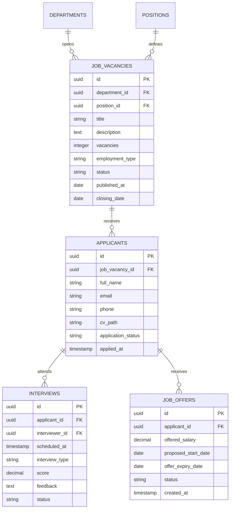

### Entity Description

**job_vacancies**

Menyimpan informasi lowongan pekerjaan.

**applicants**

Menyimpan data pelamar.

**interviews**

Menyimpan jadwal dan hasil interview.

**job_offers**

Menyimpan penawaran kerja kepada kandidat.

### Relationships

- One Department can have multiple Job Vacancies.
- One Position can have multiple Job Vacancies.
- One Job Vacancy can receive multiple Applicants.
- One Applicant can have multiple Interviews.
- One Applicant can receive multiple Job Offers.

---

## 3.10 Training & Development ERD

Mengelola program pelatihan dan partisipasi karyawan.

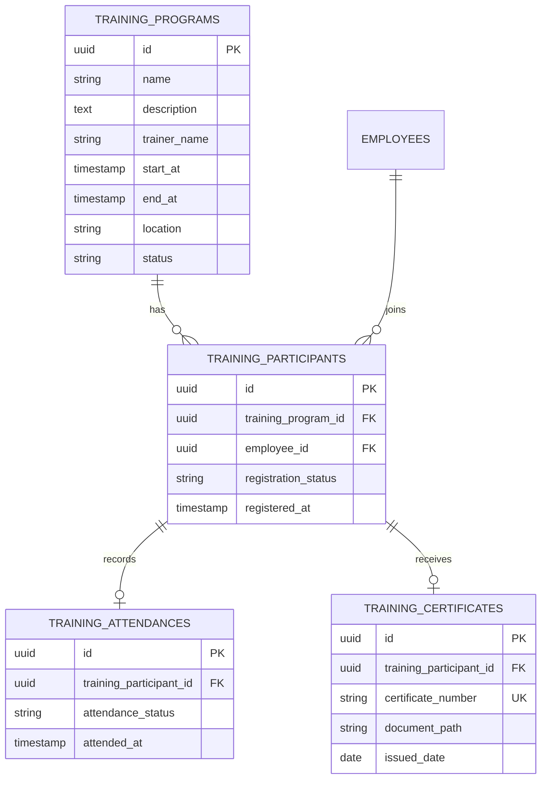

### Entity Description

**training_programs**

Menyimpan program pelatihan.

**training_participants**

Menyimpan peserta pelatihan.

**training_attendances**

Mencatat kehadiran peserta.

**training_certificates**

Menyimpan sertifikat pelatihan.

### Relationships

- One Training Program can have multiple Participants.
- One Employee can participate in multiple Training Programs.
- One Training Participant can have one Attendance Record.
- One Training Participant can receive one Certificate.

---

## 3.11 Document Management ERD

Mengelola dokumen yang berkaitan dengan karyawan dan operasional HR.

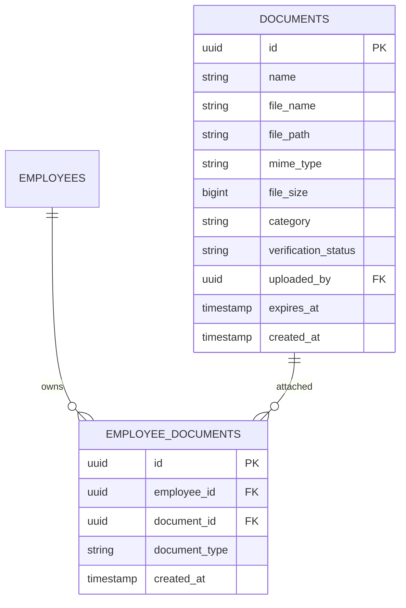

### Entity Description

**documents**

Menyimpan metadata dokumen dan lokasi penyimpanan file.

**employee_documents**

Menghubungkan dokumen dengan karyawan.

### Relationships

- One Employee can have multiple Documents.
- One Document can be associated with multiple Employee Document records jika memang dibutuhkan oleh kebijakan penyimpanan.

File fisik disimpan di file storage, bukan sebagai binary langsung dalam tabel PostgreSQL.

---

## 3.12 Notifications & Audit Trail ERD

Mengelola notifikasi pengguna dan aktivitas sistem.

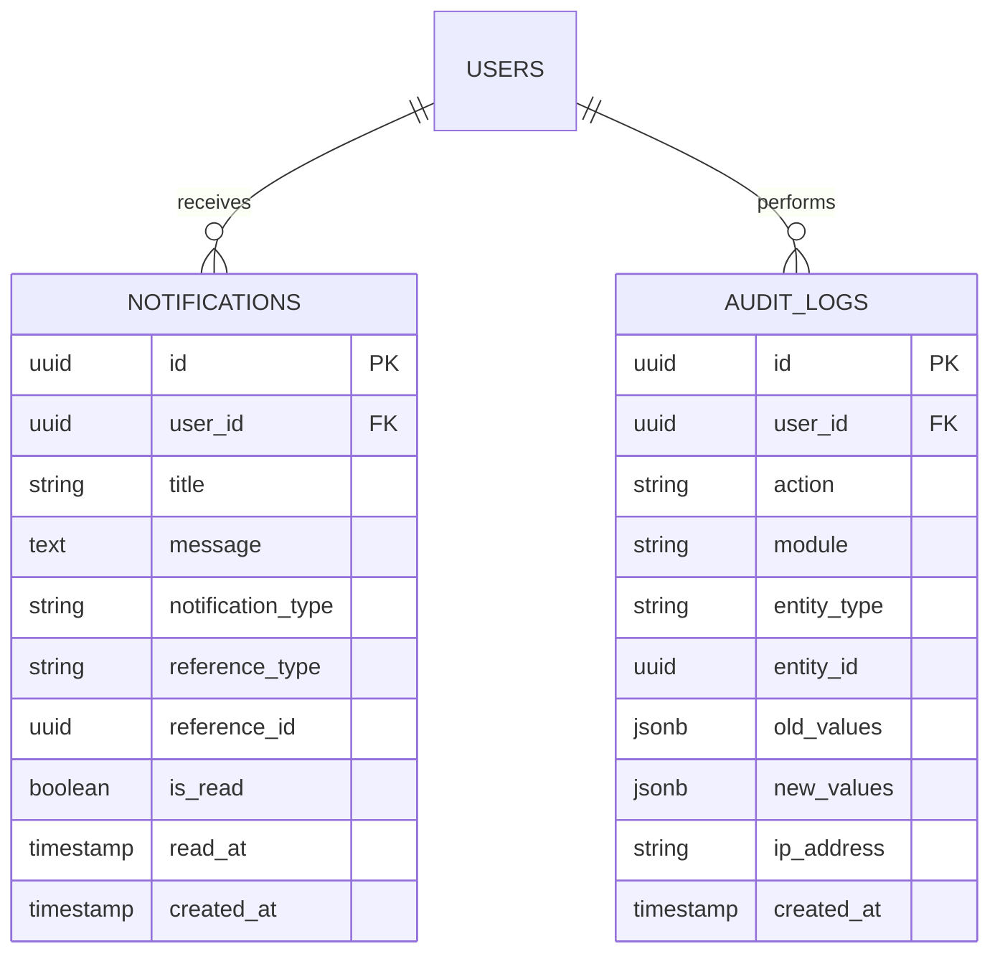

### Entity Description

**notifications**

Menyimpan notifikasi untuk setiap pengguna.

**audit_logs**

Menyimpan riwayat aktivitas penting pengguna.

### Relationships

- One User can receive multiple Notifications.
- One User can perform multiple Audit Log activities.

---

# 4. Global Entity Relationships

Bagian ini memperlihatkan hubungan antar domain utama dalam satu diagram konseptual.

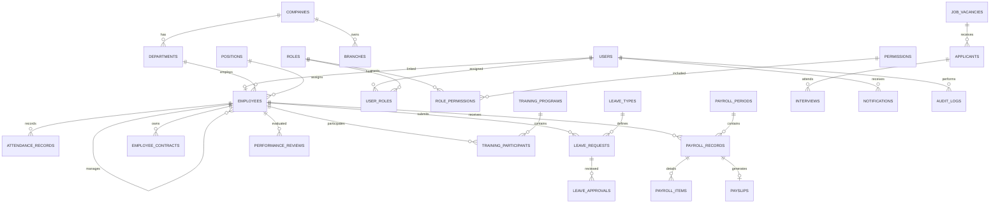

---

# 5. Database Constraints & Business Rules

Bagian ini menjelaskan aturan integritas data yang harus diterapkan pada PostgreSQL.

## 5.1 Primary Key

Semua tabel utama menggunakan UUID.

Contoh:

```sql
id UUID PRIMARY KEY DEFAULT gen_random_uuid()
```

Pastikan extension `pgcrypto` tersedia jika menggunakan `gen_random_uuid()` pada versi PostgreSQL yang memerlukannya.

## 5.2 Unique Constraints

Beberapa kolom harus memiliki nilai unik.

| Table | Column | Constraint |
|---|---|---|
| users | email | UNIQUE |
| employees | employee_number | UNIQUE |
| employees | national_id | UNIQUE |
| branches | code | UNIQUE |
| departments | code | UNIQUE sesuai company |
| roles | name | UNIQUE |
| permissions | name | UNIQUE |
| leave_types | code | UNIQUE |
| employee_contracts | contract_number | UNIQUE |
| training_certificates | certificate_number | UNIQUE |

## 5.3 Foreign Key Constraints

Seluruh foreign key harus memiliki referensi yang valid.

Contoh:

```sql
employee_id UUID NOT NULL REFERENCES employees(id)
```

Penggunaan ON DELETE harus ditentukan berdasarkan kebutuhan bisnis.

Rekomendasi:

- `RESTRICT` untuk data transaksi penting.
- `CASCADE` untuk tabel penghubung yang benar-benar bergantung pada parent.
- `SET NULL` untuk relasi opsional yang boleh kehilangan referensi.

Hindari menggunakan CASCADE secara luas pada tabel payroll, attendance, contract, dan audit logs.

## 5.4 Check Constraints

Contoh aturan validasi:

```sql
CHECK (end_date >= start_date)
```

Untuk payroll:

```sql
CHECK (gross_salary >= 0)
```

```sql
CHECK (total_deductions >= 0)
```

Untuk attendance:

```sql
CHECK (
    check_out_at IS NULL
    OR check_out_at > check_in_at
)
```

Untuk leave balance:

```sql
CHECK (entitled_days >= 0)
```

```sql
CHECK (used_days >= 0)
```

## 5.5 Transactional Integrity

Operasi berikut harus menggunakan database transactions:

1. Payroll processing.
2. Payroll finalization.
3. Leave approval dan pengurangan saldo cuti.
4. Attendance correction approval.
5. Employee onboarding.
6. Employee transfer.
7. Salary adjustment.

Untuk operasi yang dapat dipanggil berulang kali, gunakan mekanisme idempotency atau unique constraints untuk mencegah transaksi ganda.

---

# 6. Indexing Strategy

Index digunakan untuk mempercepat query pada kolom yang sering digunakan.

| Table | Column | Index Type |
|---|---|---|
| users | email | UNIQUE |
| employees | employee_number | UNIQUE |
| employees | department_id | B-tree |
| employees | position_id | B-tree |
| employees | employment_status | B-tree |
| attendance_records | employee_id, work_date | Composite |
| attendance_records | work_date | B-tree |
| leave_requests | employee_id, status | Composite |
| leave_requests | start_date, end_date | Composite |
| leave_balances | employee_id, leave_type_id, year | UNIQUE |
| payroll_records | payroll_period_id, employee_id | UNIQUE |
| payroll_records | status | B-tree |
| employee_contracts | employee_id | B-tree |
| employee_contracts | end_date | B-tree |
| performance_reviews | employee_id, evaluation_period_id | B-tree |
| notifications | user_id, is_read | Composite |
| audit_logs | user_id, created_at | Composite |

Index harus dievaluasi menggunakan query workload aktual. Jangan membuat index berlebihan karena dapat memperlambat operasi INSERT dan UPDATE.

---

# 7. Important Database Design Decisions

## 7.1 Employee and User Separation

Tabel `users` dan `employees` dipisahkan.

Alasannya:

- User merupakan akun untuk mengakses sistem.
- Employee merupakan identitas seseorang dalam organisasi.
- Tidak semua akun sistem harus menjadi karyawan.
- Data pekerjaan tidak boleh tercampur dengan autentikasi.

Relasi yang digunakan:

`users 1 : 0..1 employees`

## 7.2 Historical Data

Informasi berikut harus memiliki riwayat:

- Employee employment history.
- Salary structure.
- Employee contracts.
- Performance reviews.
- Payroll records.

Tujuannya agar perubahan informasi tidak menghilangkan data historis.

## 7.3 Payroll Snapshot

Payroll harus menyimpan nilai komponen penghasilan dan potongan pada saat payroll diproses.

Contoh:

Jika basic salary karyawan berubah dari Rp5.000.000 menjadi Rp6.000.000, payroll bulan sebelumnya harus tetap menggunakan nominal yang berlaku saat payroll tersebut diproses.

Karena itu, `payroll_items` menyimpan snapshot nominal, bukan hanya referensi ke salary components.

## 7.4 Leave Balance

Leave balance dipisahkan dari leave requests karena keduanya memiliki tanggung jawab berbeda.

- `leave_requests` menyimpan pengajuan.
- `leave_balances` menyimpan saldo cuti.
- `leave_approvals` menyimpan riwayat keputusan.

Perubahan saldo harus dilakukan dalam transaksi database.

## 7.5 Document Storage

File dokumen tidak disimpan langsung dalam database.

PostgreSQL hanya menyimpan metadata seperti:

- File name.
- File path.
- MIME type.
- File size.
- Document category.
- Expiration date.

File fisik disimpan di local storage atau object storage.

## 7.6 Audit Trail

Audit logs menggunakan JSONB untuk menyimpan informasi perubahan data.

Contoh:

```json
{
  "old_values": {
    "department_id": "old-department-id"
  },
  "new_values": {
    "department_id": "new-department-id"
  }
}
```

Audit logs bersifat append-only melalui mekanisme aplikasi dan tidak boleh dapat dimodifikasi oleh pengguna biasa.

---

# 8. Recommended Database Implementation Order

Urutan pembuatan migration disarankan mengikuti dependensi foreign key.

| Order | Domain | Tables |
|---|---|---|
| 1 | Authentication | users, roles, permissions, user_roles, role_permissions, refresh_tokens |
| 2 | Organization | companies, branches, departments, divisions, job_grades, positions |
| 3 | Employee | employees, employee_contacts, employee_addresses, employee_emergency_contacts, employee_bank_accounts, employee_employment_histories |
| 4 | Attendance | work_shifts, work_schedules, holidays, attendance_records, attendance_corrections |
| 5 | Leave | leave_types, leave_policies, leave_balances, leave_requests, leave_approvals |
| 6 | Payroll | salary_structures, salary_components, payroll_periods, payroll_records, payroll_items, payroll_adjustments, payslips |
| 7 | Contract | documents, employee_contracts, contract_documents |
| 8 | Performance | kpis, evaluation_periods, performance_reviews, performance_scores, performance_feedback |
| 9 | Recruitment | job_vacancies, applicants, interviews, job_offers |
| 10 | Training | training_programs, training_participants, training_attendances, training_certificates |
| 11 | Document | employee_documents |
| 12 | System | notifications, audit_logs |

Catatan: urutan tersebut merupakan urutan dependensi konseptual. Beberapa tabel dapat dibuat dalam migration yang sama jika dependensinya sudah tersedia.

---

# 9. Database Seeder Requirements

Seeder digunakan untuk memasukkan data awal aplikasi.

Data yang perlu disiapkan:

## 9.1 Authentication Seeder

- Super Admin role.
- HR Admin role.
- HR Manager role.
- Department Manager role.
- Employee role.
- Default permissions.
- Role permissions.
- Initial administrator account.

## 9.2 Organization Seeder

- Default company.
- Sample branches.
- Sample departments.
- Sample divisions.
- Sample job grades.
- Sample positions.

## 9.3 HR Configuration Seeder

- Leave types.
- Leave policies.
- Default work shifts.
- Default holidays (jika tersedia).
- Payroll component definitions.

Seeder harus idempotent agar dapat dijalankan berulang kali tanpa membuat data duplikat.

---

# 10. ERD Scope & Future Improvements

Beberapa kebutuhan berikut dapat ditambahkan pada pengembangan berikutnya:

1. Multi-company organizational assignments.
2. Multi-tenant data isolation.
3. Employee benefits management.
4. Employee asset management.
5. Advanced workforce scheduling.
6. Multiple attendance punches.
7. Tax regulation versioning.
8. BPJS configuration history.
9. Payroll payment reconciliation.
10. Advanced approval workflow engine.
11. Employee offboarding checklist.
12. Employee skills and competency framework.

---

# 11. Conclusion

Database PeopleCore HRIS dirancang menggunakan pendekatan relational database dengan pemisahan domain berdasarkan tanggung jawab masing-masing modul.

Rancangan ini mendukung integrasi antara employee management, attendance, leave, payroll, contract, performance, recruitment, training, dan document management.

Pemisahan master data, transactional data, dan historical records bertujuan menjaga integritas serta konsistensi informasi sepanjang siklus kerja karyawan.

Database ini menjadi dasar implementasi backend Golang dan integrasi frontend React pada PeopleCore HRIS.

**End of Document — PeopleCore HRIS ERD v1.0**
